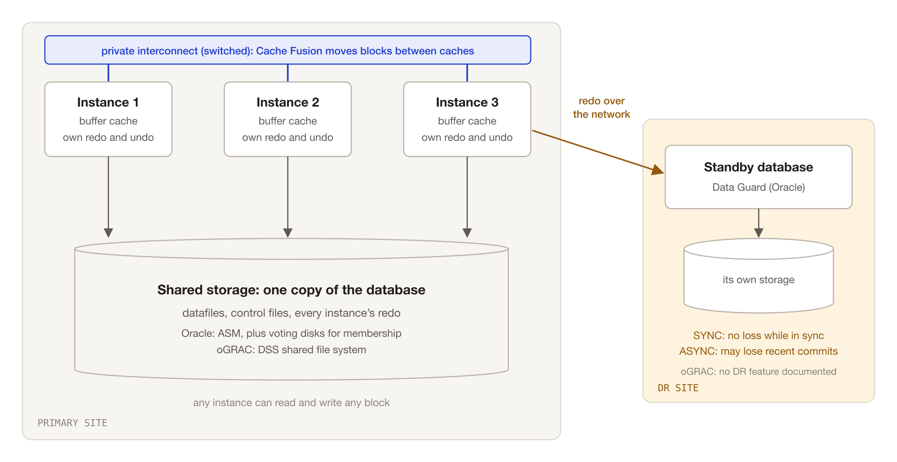
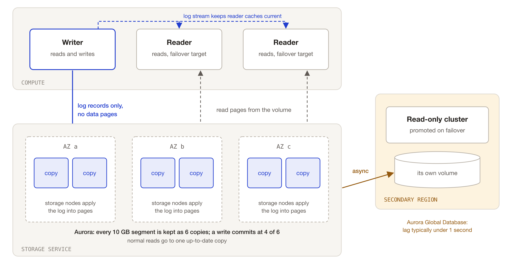
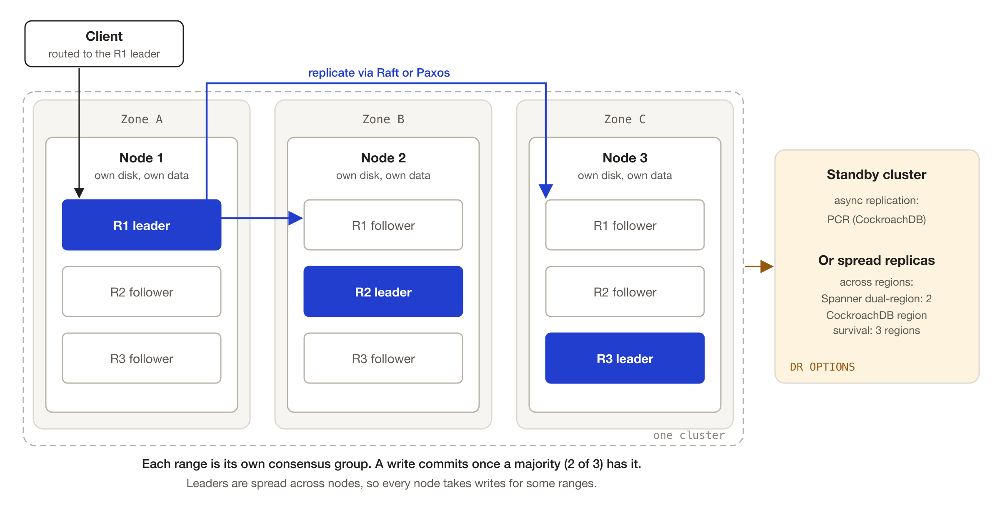

Run a database on more than one server and you have to decide who owns the data. There are three answers: share one disk, share a smart storage service, or share nothing.

For each one I'll cover what it gives you, its high availability (HA) story, meaning surviving a dead server or zone, and its disaster recovery (DR) story, meaning surviving a dead site or region.

---

## Shared-disk: Oracle RAC and oGRAC

Several database instances run on separate servers and open the same database on shared storage. Any instance can read and write any block. When instance 2 needs a block that instance 1 has changed in memory, Oracle's Cache Fusion ships it across a private interconnect instead of reading a stale copy from disk. oGRAC, the openGauss community's open-source equivalent, uses the same design.

**What you get:** one database with several engines in front of it. Add a server, get more compute, move no data.

**HA:** Oracle Clusterware tracks which nodes are alive through voting disks and evicts a node that loses contact, so two halves of a cluster never both write. Survivors take over the dead node's work, which Oracle says is "measured in seconds." The weak spot is that everything depends on one storage system in one building.

**DR:** Oracle Data Guard ships redo to a standby database on separate storage. Synchronous mode loses nothing while the standby is in sync. Asynchronous mode is faster but can lose the last few commits. oGRAC's docs don't describe a DR feature yet.

---

## Shared-storage: Aurora and AlloyDB

One writer and several readers attach to the same storage service. The writer never writes data pages. It sends only log records, and the storage layer turns them into pages. In Aurora, every 10 GB segment is kept as six copies across three availability zones, and a write commits once four copies have it. AlloyDB first writes the log to a regional log store, then builds pages from it in the background.

**What you get:** storage that survives a zone failure without any replication for you to manage, and new readers in minutes because no data is copied. You still get only one writer.

**HA:** if the writer dies, a reader takes over. AWS says Aurora is "typically restored in less than 60 seconds." AlloyDB keeps a standby node in another zone and loses no data on failover, because every commit has already reached its regional log store.

**DR:** Aurora Global Database replicates to other regions with lag typically under a second. A planned switchover loses nothing. An unplanned failover can lose a few seconds of writes and takes minutes. AlloyDB offers asynchronous secondary clusters in other regions that you promote when needed.

---

## Shared-nothing: Spanner and CockroachDB

The data is cut into small ranges, and each range is copied to three or more nodes. The copies of a range elect a leader using a consensus protocol, Paxos in Spanner and Raft in CockroachDB. A write commits once a majority of the copies have it. Leaders are spread across nodes, so every node takes writes.

**What you get:** writes that scale by adding nodes, and no shared component to fail.

**HA:** there is no failover step. If a node dies, the remaining copies elect a new leader within seconds and keep going without losing committed data.

**DR:** there are two options. You can spread the copies across regions, which turns a region outage into a normal HA event. That takes two regions for Spanner's dual-region setup and three for CockroachDB's region survival goal, and every write then waits on a cross-region round trip. Or you can run a separate standby cluster with asynchronous replication, such as CockroachDB's physical cluster replication, which lags by tens of seconds.

---

## Side by side

| | Shared-disk | Shared-storage | Shared-nothing |
| --- | --- | --- | --- |
| Writers | every node | one | every node |
| Weak spot | the shared storage | one region | write latency |
| Server failure | seconds | under a minute | seconds |
| DR | standby database | cross-region replica | multi-region or standby cluster |

---

## Which one for which workload

| Workload | Pick | Why |
| --- | --- | --- |
| Oracle app you can't rewrite (ERP, core banking) | Shared-disk | more compute with no application changes |
| Typical web or SaaS app on PostgreSQL or MySQL | Shared-storage | standard engine, fast failover, little to operate |
| Read-heavy app with traffic spikes | Shared-storage | add readers in minutes, no data copy |
| Users writing from several regions (payments, inventory, accounts) | Shared-nothing | writes close to users, survives a region |
| Write volume beyond one large server | Shared-nothing | the only design here that adds writers |
| Small app in one region | none of these | a single primary with a standby in another zone is enough |

The last row matters most. All three designs cost more and have more failure modes than a plain primary and standby. Reach for one only when your workload actually needs what it adds.

---

## What others chose

These aren't endorsements, just public write-ups of where each design ended up.

**Shared-disk.** Oracle documents RAC deployments for [E-Business Suite](https://docs.oracle.com/cd/E26401_01/doc.122/e22953/T174296T174307.htm) and [Siebel CRM](https://docs.oracle.com/en/applications/siebel/siebel-crm/26.3/szsig/c-Guidelines-for-Using-Real-Application-Clustersfor-an-Oracle-Database-aif1634258.html), and SAP [documents RAC support](https://help.sap.com/doc/saphelp_nw75/7.5.5/en-US/47/1780d36e8a21c3e10000000a114a6b/content.htm) for SAP systems running on Oracle. These are packaged enterprise applications built around one Oracle database, which is exactly what RAC scales.

**Shared-storage.** [Atlassian moved Jira Cloud](https://www.atlassian.com/blog/atlassian-engineering/migrating-jira-database-platform-to-aws-aurora) to Aurora PostgreSQL, around 4 million tenant databases across 13 AWS regions. [DraftKings runs its financial ledger](https://aws.amazon.com/solutions/case-studies/draftkings-aurora-case-study) on Aurora MySQL. [Urban Outfitters chose AlloyDB](https://cloud.google.com/blog/products/databases/urban-outfitters-moves-sterling-oms-to-alloydb-for-postgresql/) for its order management system when it moved off Oracle.

**Shared-nothing.** Google built [F1, the database behind AdWords](https://research.google/pubs/f1-a-distributed-sql-database-that-scales/), on Spanner, and [Uber's trip and delivery platform](https://www.uber.com/en-US/blog/building-ubers-fulfillment-platform/) runs on it too. [DoorDash runs CockroachDB](https://www.cockroachlabs.com/blog/doordash-cockroachdb-massive-scale/) at about 1.2 million queries per second, and [Hard Rock Digital's sportsbook](https://www.cockroachlabs.com/blog/highly-available-sports-betting-app/) uses it to keep betting data inside each US state.

The pattern is consistent: packaged enterprise apps tied to Oracle on shared-disk, SaaS and transactional apps that fit one writer on shared-storage, and platforms that write from many places at once on shared-nothing.

Whichever you choose, none of these is a backup. All of them will copy a bad `DELETE` to every replica within seconds.
